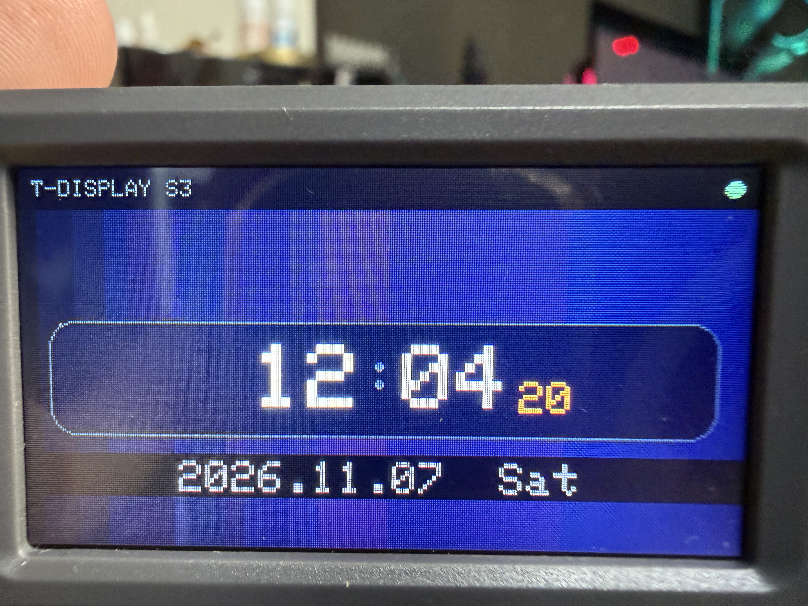

# T-Display-S3 NTP 時鐘 ⏰

[LilyGO T-Display-S3](https://lilygo.cc/products/t-display-s3)（原版，非 AMOLED）上的精緻 Wi-Fi NTP 時鐘。
ESP32-S3 + 1.9" IPS TFT 170×320（ST7789V, 8-bit parallel），Arduino / TFT_eSPI 實作。



## 功能特色

- **NTP 校時**：`configTime` + `pool.ntp.org` / `time.google.com`（台北 UTC+8），Wi-Fi 斷線自動重連
- **漸層背景**：170×320 RGB565 深藍紫漸層，由 `make_bg.py` 離線生成、燒進 flash，只繪製一次
- **精緻面板**：圓角面板框 + 細邊框、低亮度克制調色盤（近白時 / 銀藍分 / 琥珀秒 / 冷灰日期）、手繪圓點冒號（GLCD 字型附的 `:` 只有 1px 寬，視覺太弱）
- **零閃爍**：不用 LVGL、不整屏重繪 —— 有 PSRAM 時用 16-bit TFT_eSprite 大面板快存，無 PSRAM 自動退回薄面板 + 髒矩形局部更新（只重畫變化的兩位秒數）
- **橫/直方向自適應**：BOOT 鍵（GPIO0）切換，字級與版面自動縮放；第二鍵（GPIO14）切換背光亮度
- **狀態列**：頂部 Wi-Fi 狀態指示點，底部日期列，跨日才重繪

## 檔案結構

```
t-display 小時鐘/
├── README.md                 ← 本檔
├── make_bg.py                ← 產生背景標頭的 Python 腳本（不需 Arduino 環境）
└── sketch_nov7b/             ← Arduino sketch（整個資料夾就是專案）
    ├── sketch_nov7b.ino      ← 主程式
    └── bg_gradient.h         ← 170×320 RGB565 big-endian 漸層（make_bg.py 生成，勿手改）
```

> ⚠️ `bg_gradient.h` 是 sketch 的附屬標頭，**必須與 .ino 放在同一個資料夾**才能編譯。
> 請用整個資料夾的方式 clone / 分享，不要只複製 .ino。

## 硬體

| 項目 | 規格 |
|---|---|
| 板子 | LilyGO T-Display-S3（原版：ESP32-S3R8, 16MB flash / 8MB PSRAM） |
| 螢幕 | 1.9" IPS TFT，170×320，ST7789V，**8-bit parallel** |
| 按鍵 | BOOT = GPIO0（轉方向），Button2 = GPIO14（背光） |
| 週邊電源 | **GPIO15 必須拉 HIGH**，否則螢幕不亮（程式已處理） |
| 背光 | GPIO38，PWM 5kHz / 8-bit（Arduino core 3.x 新 `ledcAttach` API） |

## 軟體需求

- **Arduino IDE 2.x**（任何支援 board manager 的版本）
- **esp32 by Espressif boards package ≥ 3.0**（本專案以 3.3.12 開發；core 3.x 的 `ledcAttach` API 是硬性需求）
- **TFT_eSPI 庫**（bodmer/TFT_eSPI，建議最新版）

## 安裝步驟

### 1. 安裝 ESP32 board package

Arduino IDE → Preferences → 「Additional boards manager URLs」加入：

```
https://espressif.github.io/arduino-esp32/package_esp32_index.json
```

Tools → Board → Boards Manager → 搜尋 `esp32` → 安裝 **esp32 by Espressif Systems**（≥3.0）。

### 2. 安裝 TFT_eSPI 並啟用 T-Display-S3 setup

Sketch → Include Library → Manage Libraries → 搜尋 `TFT_eSPI` → 安裝。

接著編輯 `<使用者文件>/Arduino/libraries/TFT_eSPI/User_Setup_Select.h`：

```diff
- #include <User_Setup.h>           // 註解掉預設
+ //#include <User_Setup.h>

  // 找到 LilyGO T-Display S3 這行, 取消註解:
- //#include <User_Setups/Setup206_LilyGo_T_Display_S3.h>
+ #include <User_Setups/Setup206_LilyGo_T_Display_S3.h>
```

> 這一步是板子接腳（8-bit parallel 資料線、CS/DC/RST、背光）正確與否的關鍵。
> 如果畫面全黑或顏色錯亂，先檢查這裡。

### 3. 設定 Wi-Fi

編輯 `sketch_nov7b/sketch_nov7b.ino` 頂部：

```cpp
#define WIFI_SSID "你的SSID"
#define WIFI_PASS "你的密碼"
```

或在 Arduino IDE → File → Preferences → 「Additional compiler flags」用巨集覆蓋，免改碼：

```
-DWIFI_SSID=\"myssid\" -DWIFI_PASS=\"mypassword\"
```

### 4. 編譯上傳

1. Tools → Board → `T-Display-S3`（若選不到，用 `ESP32S3 Dev Module`）
2. 板子選項：
   - **USB CDC On Boot: Enabled**（USB 是 native/JTAG，不開看不到序列埠輸出）
   - **PSRAM: OPI PSRAM**（啟用大面板快存；沒開也會自動退回精簡版執行）
3. 插 USB → 上傳。第一次連 Wi-Fi 約 10–20 秒完成校時。

## 操作

| 按鍵 | 功能 |
|---|---|
| BOOT（左下/側面） | 切換橫向 / 直向顯示 |
| Button2 | 循環切換背光亮度（暗 → 中 → 亮） |

## 自訂

- **改漸層顏色**：編輯 `make_bg.py` 的 `stops`（三個 RGB 色停），執行 `python make_bg.py`，會覆寫 `sketch_nov7b/sketch_nov7b/bg_gradient.h`
- **改調色盤**：.ino 頂部 `C_*` 巨集。注意兩件事：
  - 背景 bitmap 是 big-endian RGB565 → `drawBackground()` 必須 `setSwapBytes(true)`
  - 直接畫到螢幕的低亮度 UI 色（面板/邊框/底條）在這塊板上呈 R/B 交換，調暗色時要先做 R/B 預交換（轉 RGB8 → 交換紅藍 → 重新打包 565；RGB565 的交換是**半位元組**運算，低 nibble 色值不可直接對調 hex）
- **改 NTP 來源/時區**：.ino 內 `configTime(8 * 3600, 0, "pool.ntp.org", "time.google.com")` 這一行 — 第一個參數是 UTC 偏移秒數（台北 `8*3600`），第二個是日光節約（`0`），後面換成任何 NTP server

## 常見問題

| 症狀 | 原因 / 解法 |
|---|---|
| 螢幕全黑 | `User_Setup_Select.h` 未啟用 Setup206；或 GPIO15 電源未開（本程式已拉 HIGH） |
| 畫面顏色紅藍互換 | 背景：反轉 `setSwapBytes()`；UI 色：見上方「改調色盤」的 R/B 說明 |
| 秒數超出螢幕/跑版 | GLCD 字寬公式是 `cw = tsz*5 + (tsz-1)`，不是 `tsz*6`（本專案已用正確公式） |
| 整行文字微微閃爍 | 大面積重繪所致；維持本專案的局部更新策略即可避免 |
| 看不到序列埠 | USB CDC On Boot 未 Enabled |
| 上傳不進去 | 按住 BOOT → 點一下 RST → 放開 BOOT，進入下載模式再上傳 |

## 授權 / 備註

- 本專案程式碼採 MIT（見 `LICENSE`，可自行調整）
- TFT_eSPI 為 Bodmer 的授權（FOSS exception），背景標頭由附帶腳本生成、無第三方圖檔
- 開發環境：Windows + Arduino IDE + esp32 core 3.3.12 + TFT_eSPI（Setup206）
